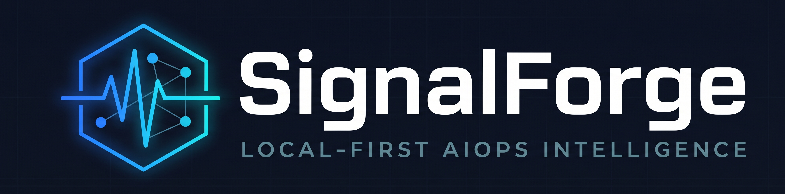
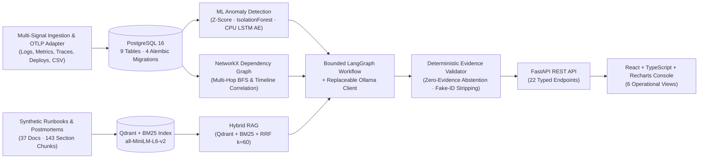

<p align="center">
  
</p>

<p align="center">
  
  
  
  
  
  
  
  
  
</p>

---

**SignalForge** is an integrated, local-first **AIOps Investigation Platform** — not a generic document chatbot over static runbooks.  
It unifies **live multi-signal telemetry** (logs, metrics, trace spans, deployments, incidents), **leakage-free CPU anomaly detection**, **trace-derived dependency topology**, and **Hybrid RAG** inside a **bounded LangGraph workflow**.  
Every investigation enforces programmatic **anti-hallucination** (zero-evidence abstention, deterministic citation hydration, fake-ID stripping) and **explicit non-causation** guardrails so hypotheses are clearly separated from confirmed facts.

> **Scope & Provenance Note:** SignalForge is a local-first engineering platform and portfolio/research project — not a hosted commercial SaaS product. All bundled datasets, benchmark suites, and 37 operations knowledge-base documents are explicitly labeled **synthetic** (`is_synthetic: true`) and are never presented as production traffic.

---

## Architecture at a Glance



SignalForge is organized into **7 modular layers** with AST-enforced import boundaries (pure domain packages under `services/` and `evaluation/` contain zero `fastapi`, `sqlalchemy`, `pickle`, or `joblib` imports):

1. **Multi-Signal Ingestion & OTLP Adapter (`services/ingestion/`):** Schema validation, UTC timestamp normalization, SHA-256 deduplication, partial-batch failure isolation (`ingestion_failures`), CSV metric upload, and offline OpenTelemetry JSONL capture ingestion (`scripts/ingest_otel_capture.py`).
2. **Unified PostgreSQL 16 Schema (`database/migrations/`):** 9 tables managed by 4 reversible Alembic migrations (`services`, `events`, `metric_points`, `trace_spans`, `deployments`, `incidents`, `anomalies`, `investigations`, `ingestion_failures`).
3. **Multivariate Anomaly Detection (`services/anomaly_detection/`):** Leakage-free chronological preprocessing, causal sliding windows, `RollingZScoreDetector`, `IsolationForestDetector`, and CPU PyTorch `LSTMAutoencoderDetector`.
4. **Hybrid Operations Knowledge RAG (`services/retrieval/`):** Section-aware Markdown chunking (deterministic UUID5 chunks), CPU `sentence-transformers/all-MiniLM-L6-v2` embeddings in Qdrant, JSON-persisted `BM25Okapi`, and Reciprocal Rank Fusion (`rrf_k=60`).
5. **Service Dependency Graph & Correlation (`services/graph/`):** Directed `caller -> callee` topology built via PostgreSQL self-join on parent/child `trace_spans`, cycle-safe multi-hop BFS impact analysis, and chronological timeline correlation with explicit non-causation disclaimers.
6. **Bounded LangGraph Investigation Workflow (`services/investigation/`):** Acyclic `StateGraph` (`plan_investigation` -> `collect_evidence` -> `abstain_no_evidence` OR `synthesize_report` -> `validate_evidence`) with replaceable `OllamaClient` (`num_ctx=8192`, JSON schema output), zero-evidence short-circuiting, deterministic citation hydration, hallucination stripping, and graceful LLM-unavailable fallback.
7. **FastAPI REST API & 6-Screen React Console (`apps/api/`, `apps/web/`):** 22 typed REST endpoints with explicit CORS and a React 18 / TypeScript / Vite / Recharts console with an application-wide `ErrorBoundary`.

### 6-Screen Local AIOps Console (`apps/web/`)

| Screen | Route | Operational Capabilities |
| --- | --- | --- |
| **Operations Overview** | `/` | Live PostgreSQL KPI cards, `/health` status pill, recent anomalies, events, open incidents, and persisted investigations |
| **Services & Dependencies** | `/services` | Auto-discovered service registry, trace-derived `caller -> callee` edge metrics, and interactive multi-hop BFS impact explorer |
| **Telemetry & Anomalies** | `/telemetry` | Recharts metric time-series with red anomaly overlays, anomaly score vs. threshold charts, and on-demand CPU detector execution |
| **Incident Timeline** | `/timeline` | Chronological correlation of deployments (with lookback), anomalies, warning/error events, and incidents with non-causation banners |
| **Knowledge Explorer** | `/knowledge` | One-click synthetic KB indexing plus `hybrid` / `dense` / `bm25` retrieval with service/doc-type filters and chunk metadata |
| **AI Investigations** | `/investigations` | Bounded LangGraph execution form, executed-node audit trail, grounded vs. abstained status, validation warnings, and cited sources |

---

## Measured Evaluation Summary

All metrics below are reproduced directly from raw JSON artifacts saved under `experiments/benchmarks/`. Every dataset, fault injection scenario, and knowledge document is explicitly labeled **synthetic**.

### 1. Multivariate Anomaly Detection (Held-Out Test Split, Synthetic `seed=42`, 5 Unseen Faults)

Reproduce: `.venv\Scripts\python scripts/run_anomaly_benchmark.py` · Report: [anomaly_detection_benchmark.md](docs/experiments/anomaly_detection_benchmark.md)

| Detector | Precision | Recall | F1 | PR-AUC | Faults | Mean Delay (min) | FP / Hour | Fit (s) |
| --- | ---: | ---: | ---: | ---: | :---: | ---: | ---: | ---: |
| `RollingZScoreDetector` (`w=30`) | 0.4502 | 0.9131 | 0.6031 | 0.5176 | 5 / 5 | 0.0 | 52.4602 | 0.0007 |
| `IsolationForestDetector` (`n=200`) | 0.9986 | 0.8318 | **0.9076** | **0.9948** | 5 / 5 | 9.8 | 0.0531 | 0.6658 |
| `LSTMAutoencoderDetector` (`h=32, z=16, e=25`) | **1.0000** | 0.8307 | 0.9075 | 0.9929 | 5 / 5 | 29.6 | **0.0000** | 149.3922 |

### 2. Hybrid Knowledge Retrieval (24 Curated Queries, 37 Synthetic Docs / 143 Chunks, Live Qdrant + CPU)

Reproduce: `.venv\Scripts\python scripts/run_retrieval_benchmark.py` · Report: [retrieval_benchmark.md](docs/experiments/retrieval_benchmark.md)

| Mode | Recall@5 | MRR@10 | nDCG@10 | Citation Completeness | p50 (ms) | p95 (ms) |
| --- | ---: | ---: | ---: | ---: | ---: | ---: |
| `bm25` | 0.9861 | 0.9514 | 0.9384 | 1.0000 | 3.15 | 7.57 |
| `dense` (`all-MiniLM-L6-v2`) | 0.9653 | 0.9792 | 0.9540 | 1.0000 | 52.63 | 123.31 |
| `hybrid` (RRF, `k=60`) | **0.9861** | **0.9792** | **0.9673** | **1.0000** | 53.66 | 70.02 |

### 3. End-to-End Pipeline & Guardrails (`--mode deterministic`, 8 Synthetic Scenarios + Adversarial Probe)

Reproduce: `.venv\Scripts\python scripts/run_e2e_evaluation.py --mode deterministic` · Report: [end_to_end_evaluation.md](docs/experiments/end_to_end_evaluation.md)

| Metric (Synthetic Suite, `--mode deterministic`, Live Qdrant + CPU RAG) | Measured Value |
| --- | ---: |
| Affected Service F1 (8 synthetic scenarios) | **1.0000** (`8/8`) |
| Live KB Expected Document Recall (`top_k=5` chunks) | `0.8095` |
| Zero-Evidence Abstention Accuracy (`0` LLM calls on empty window) | **1.0000** (`8/8`) |
| Adversarial Hallucination Probe Interception (fake `doc_id`s, fake `evidence_id`s, unsupported claims) | **1.0000** (`7/7`) |
| Post-Validation Unsupported Claim Rate / Citation Correctness | `0.0000` / **1.0000** |
| End-to-End Deterministic Workflow Latency (`p50` / `p95`) | `57.30 ms` / `82.10 ms` |

> **Live Local LLM Note:** The metrics above validate orchestration, live Qdrant Hybrid RAG, topology, and deterministic validator guardrails under `--mode deterministic`. Live Ollama synthesis quality has **not** yet been benchmarked; run `.venv\Scripts\python scripts/run_e2e_evaluation.py --mode ollama` with a running Ollama daemon (`qwen2.5:7b`) to measure live LLM synthesis directly.

### 4. Local System Performance (`signalforge_test`, Windows 11, Python 3.12.14, 16 CPUs)

Reproduce: `.venv\Scripts\python scripts/run_system_benchmark.py` · Artifact: [system_perf.json](experiments/benchmarks/end_to_end/system_perf.json)

| Workload / Endpoint (Synthetic Benchmark) | Measured Result |
| --- | ---: |
| Event Ingestion Throughput (`1,000`-event batch) | `1,002.40 events/s` |
| Metric Ingestion Throughput (`2,000`-point batch) | `1,880.26 metrics/s` |
| `GET /health` (`p50` / `p95`, 20 requests) | `7.17 ms` / `10.53 ms` |
| `GET /api/v1/events` (`p50` / `p95`, 20 requests) | `13.98 ms` / `17.24 ms` |
| `GET /api/v1/metrics` (`p50` / `p95`, 20 requests) | `16.77 ms` / `19.21 ms` |
| `GET /api/v1/graph/dependencies` (`p50` / `p95`, 20 requests) | `15.01 ms` / `18.39 ms` |
| `POST /api/v1/anomalies/detect` (`lstm_autoencoder`, 46 pts, `p50` / `p95`) | `38.97 ms` / `41.71 ms` |
| `POST /api/v1/correlation/timeline` (`p50` / `p95`, 20 requests) | `37.95 ms` / `61.68 ms` |
| `POST /api/v1/investigations/run` (`--mode deterministic`, `p50` / `p95`) | `92.09 ms` / `136.54 ms` |
| Python Process RSS Memory Footprint | `435.91 MB` -> `467.32 MB` |

---

## 5-Minute Local Quickstart (Windows / Clean Checkout)

### Prerequisites
- Python 3.12 + [`uv`](https://docs.astral.sh/uv/)
- Docker Desktop (Linux containers enabled)
- Node.js 22+ & npm (for `apps/web/`)
- *(Optional)* [Ollama](https://ollama.com/) with `ollama pull qwen2.5:7b` for live local LLM synthesis (SignalForge runs end-to-end and degrades cleanly to deterministic abstained evidence reports even when Ollama is offline)

### 1. Environment & Dependencies

```powershell
# Create Python 3.12 virtual environment
uv venv --python 3.12 .venv

# Install CPU-only PyTorch first (avoids pulling the ~2.5 GB CUDA wheel)
uv pip install --python .venv\Scripts\python.exe --index-url https://download.pytorch.org/whl/cpu "torch>=2.3,<3.0"

# Install SignalForge and dev tools
uv pip install --python .venv\Scripts\python.exe -e ".[dev]"

# Copy default local configuration
copy .env.example .env
```

### 2. Start Datastores, Migrate & Seed Synthetic Demo Scenario

```powershell
# Start PostgreSQL 16 (signalforge + signalforge_test) and Qdrant
docker compose up -d --wait

# Apply all Alembic migrations (0001..0004)
.venv\Scripts\alembic upgrade head

# Idempotently seed the synthetic e-commerce incident scenario + Qdrant KB index
.venv\Scripts\python scripts/seed_demo_scenario.py
```

### 3. Launch Backend API & React Console

```powershell
# Terminal 1 — FastAPI backend (http://127.0.0.1:8000, OpenAPI at /docs)
.venv\Scripts\uvicorn apps.api.src.main:app --reload

# Terminal 2 — React + TypeScript + Recharts console (http://127.0.0.1:5173)
cd apps/web
npm install
npm run dev
```

### Optional Full-Stack Docker Compose

Run PostgreSQL, Qdrant, FastAPI, and the Nginx-served React frontend together in containers (reaching host Ollama via `host.docker.internal:11434`):

```powershell
docker compose -f docker-compose.full.yml up --build
```

### Verification & Test Suite

```powershell
# Backend lint & full integration test suite (260 tests against PostgreSQL 16 + Qdrant)
.venv\Scripts\ruff check .
.venv\Scripts\pytest -v

# Frontend strict TypeScript check & production Vite build
cd apps/web
npx tsc --noEmit
npm run build
```

---

## Documentation & ADRs

| Category | Document | Description |
| --- | --- | --- |
| **Architecture** | [system-architecture.md](docs/architecture/system-architecture.md) | Layered system diagrams, AST boundaries, and PostgreSQL 16 schema |
| **API Reference** | [api-reference.md](docs/api/api-reference.md) | Complete specification of all 22 FastAPI REST endpoints and schemas |
| **Portfolio Case Study** | [case-study.md](docs/portfolio/case-study.md) | Problem framing, engineering trade-offs, and 5-minute demo script |
| **ADR-001** | [ADR-001-telemetry-storage-and-capture.md](docs/decisions/ADR-001-telemetry-storage-and-capture.md) | Single PostgreSQL 16 store & offline OTel JSONL capture strategy |
| **ADR-002** | [ADR-002-local-ml-and-llm-strategy.md](docs/decisions/ADR-002-local-ml-and-llm-strategy.md) | CPU PyTorch ML, `all-MiniLM-L6-v2` embeddings, and replaceable Ollama client |
| **Constitution** | [CONSTITUTION.md](docs/decisions/CONSTITUTION.md) | Non-negotiable engineering invariants, guardrails, and honest reporting rules |
| **Datasets** | [otel-capture.md](docs/datasets/otel-capture.md) | Offline OpenTelemetry JSONL capture schema and ingestion pipeline |
| **Benchmark — ML** | [anomaly_detection_benchmark.md](docs/experiments/anomaly_detection_benchmark.md) | Controlled synthetic fault benchmark ([JSON](experiments/benchmarks/anomaly_seed42/results.json)) |
| **Benchmark — RAG** | [retrieval_benchmark.md](docs/experiments/retrieval_benchmark.md) | BM25 vs. Dense vs. Hybrid RRF evaluation ([JSON](experiments/benchmarks/retrieval_kb/results.json)) |
| **Benchmark — E2E & Perf** | [end_to_end_evaluation.md](docs/experiments/end_to_end_evaluation.md) | Guardrails & local throughput/latency ([E2E JSON](experiments/benchmarks/end_to_end/e2e_results.json) · [Perf JSON](experiments/benchmarks/end_to_end/system_perf.json)) |

---

## Honest Limitations

- **Synthetic benchmarks:** Anomaly, retrieval, and E2E evaluations currently use controlled synthetic data rather than multi-week production telemetry.
- **Live Ollama benchmark pending:** E2E metrics above verify orchestration, live Qdrant Hybrid RAG, topology, and validator guardrails in `--mode deterministic`; live local `qwen2.5:7b` synthesis quality and multi-second generation latency require running `--mode ollama` with a running Ollama daemon.
- **Single-node local storage:** Unpartitioned PostgreSQL 16 is ideal for local development and moderate ingestion (`~1k–1.9k rows/s`), whereas large production deployments would require partitioned TSDB storage and distributed worker queues.

---

## License

MIT License — see [LICENSE](LICENSE).
