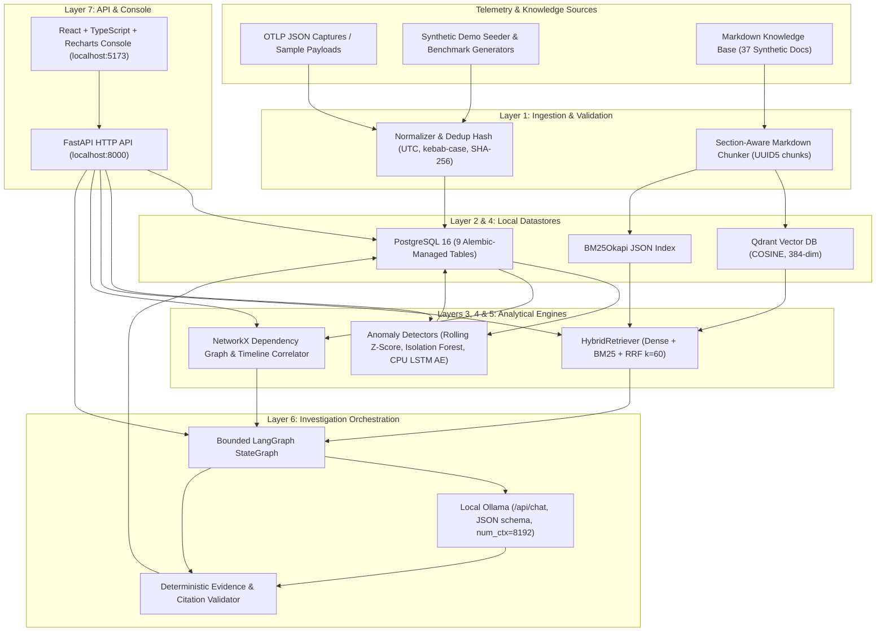
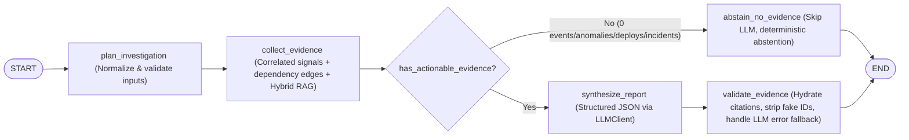
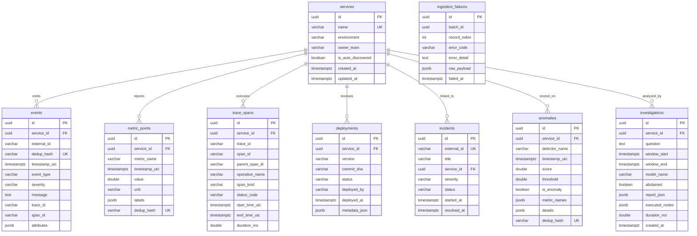

# SignalForge System Architecture

SignalForge is a local-first AI-powered IT Operations Intelligence Platform (AIOps) engineered to correlate multi-signal operational telemetry, detect multivariate anomalies, retrieve grounded operational knowledge, and orchestrate bounded incident investigations on a single developer workstation (16 GB RAM / optional 8 GB VRAM).

## 1. Seven-Layer Modular Architecture

| Layer | Directory | Responsibility |
| --- | --- | --- |
| **1. Telemetry Ingestion & Normalization** | `services/ingestion/` | Validates, normalizes service names & UTC timestamps, computes deterministic SHA-256 deduplication hashes, parses OTLP JSON captures, and isolates invalid records into `ingestion_failures`. |
| **2. Unified Relational Storage** | `apps/api/src/models/`, `database/migrations/` | Single PostgreSQL 16 database managed via 4 reversible Alembic migrations (`0001`–`0004`) across 9 tables. |
| **3. Multivariate Anomaly Detection** | `services/anomaly_detection/` | Leakage-free chronological preprocessing, 7-feature sliding windows, `RollingZScoreDetector`, `IsolationForestDetector`, and CPU PyTorch `LSTMAutoencoderDetector` with JSON/state-dict serialization (zero `pickle`). |
| **4. Hybrid Knowledge RAG** | `services/retrieval/` | Section-aware Markdown chunker (deterministic UUID5 `chunk_id`s), CPU `all-MiniLM-L6-v2` embeddings, Qdrant cosine search, JSON-persisted `BM25Okapi` index, and Reciprocal Rank Fusion (RRF). |
| **5. Service Dependency Graph & Correlation** | `services/graph/` | Pure NetworkX directed graph (`caller -> callee`) derived via SQLAlchemy self-join on parent/child `trace_spans`, cycle-safe multi-hop BFS impact traversal, and chronological timeline correlation with explicit non-causation disclaimers. |
| **6. Bounded Investigation Orchestration** | `services/investigation/` | Acyclic LangGraph `StateGraph`, replaceable `LLMClient` (`OllamaClient` structured JSON output + `FakeLLMClient`), zero-evidence abstention short-circuit, deterministic citation hydration, and hallucination stripping. |
| **7. API & Engineering Console** | `apps/api/`, `apps/web/` | FastAPI REST API (`22` endpoints, explicit CORS) + 6-screen React 18 / TypeScript / Vite / Recharts console. |

### Architectural Boundary Enforcement

All pure domain packages (`services/anomaly_detection/`, `services/retrieval/`, `services/graph/`, `services/investigation/`, and `evaluation/`) are strictly decoupled from web frameworks, ORM layers, and unsafe binary serialization. Automated AST tests enforce zero imports of `fastapi`, `sqlalchemy`, `psycopg`, `alembic`, `starlette`, `pickle`, or `joblib` inside these packages.

---

## 2. End-to-End System Architecture

---

## 3. Bounded LangGraph Investigation Workflow

The investigation workflow in `services/investigation/workflow.py` is a strictly acyclic, bounded `StateGraph` (maximum 4 nodes executed on any request, zero open-ended tool loops):

**Safety guarantees enforced by the DAG:**
1. **Zero-evidence short-circuit:** When no actionable telemetry exists (`event`, `anomaly`, `deployment`, `incident`), the LLM is never called (`0` LLM calls) and an abstained report (`model_name="deterministic-abstention"`) is persisted.
2. **Deterministic citation hydration:** The LLM outputs only `cited_doc_ids`; `validate_evidence` hydrates `CitationRef` metadata (`title`, `section_heading`, `source_path`, `is_synthetic`) directly from `EvidenceBundle.retrieved_citations`, making fabricated titles or paths impossible.
3. **Evidence-backed hypotheses:** Fabricated `evidence_id`s are stripped with warnings, any hypothesis left with `0` valid `supporting_evidence_ids` is dropped, and every hypothesis enforces `is_proven_causation = False`.
4. **Graceful LLM failure fallback:** If Ollama is stopped, times out, or returns invalid JSON, `synthesize_report` catches `LLMClientError` and `validate_evidence` produces an HTTP `200` abstained report retaining all deterministic facts, anomalies, correlations, and retrieved citations.

---

## 4. PostgreSQL 16 Schema Overview (9 Tables)

All 9 tables are managed strictly through reversible Alembic migrations (`0001_initial_schema` → `0002_telemetry_signals` → `0003_anomalies` → `0004_investigations`):

